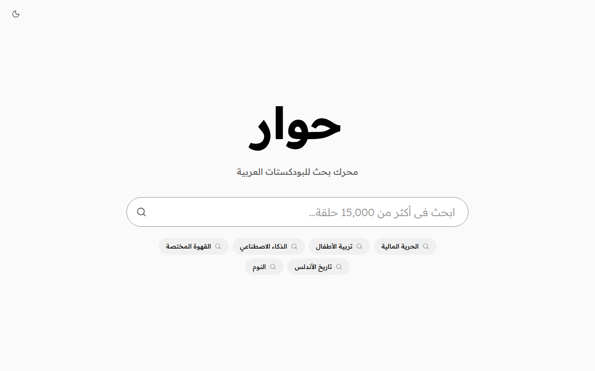

# Hiwar (حوار)

A search engine for Arabic podcasts. It searches the transcripts, titles and chapters of more than 15,000 episodes, using keyword and semantic search together, and links each result to the moment it's said.

**Live:** https://hiwar.baselalnassr.com

<p>
  
  
</p>

## Getting started

Requirements: Node.js 24 and pnpm.

```sh
pnpm install
```

The API serves the database at `rawi.db` in the repo root (or at `DB_PATH`). Its settings, listed in `services/api/src/config.ts`, can go in a `.env` file at the repo root.

Run the API (port 3000) and the frontend (port 5173):

```sh
pnpm dev
```

On first start the API downloads the bge-m3 query model (~2.3 GB) into `models/`. To skip this, set `QUERY_EMBEDDER=openrouter` and `OPENROUTER_KEY`.

## License

[MIT](LICENSE)
